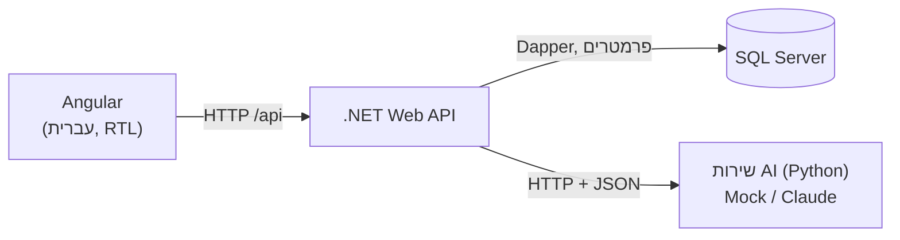
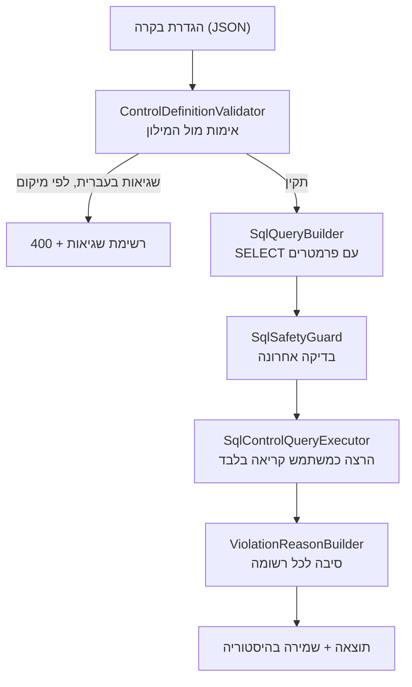
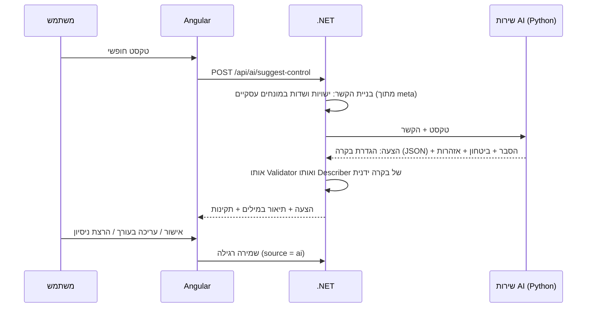

# ארכיטקטורה ומנגנון הבקרות

## עקרון מנחה

**בקרה היא נתונים, לא קוד.** כל בקרה נשמרת כמסמך JSON שמתאר תנאים במונחים עסקיים ("גיל", "מחלקה ← מחלקה פעילה"). מנוע אחד וגנרי מתרגם כל הגדרה לשאילתת SQL בטוחה ברגע ההרצה. לכן הוספת בקרה, וגם הוספת טבלה חדשה, לא דורשות שינוי קוד.

## תמונה כללית



| רכיב | אחריות | מה הוא **לא** עושה |
|---|---|---|
| Angular | ממשק למשתמש העסקי: בניית תנאים, הצגת תוצאות, שפה חופשית | לא מכיר SQL ולא שמות טבלאות |
| .NET API | מקור האמת: אימות הגדרות, בניית שאילתות, הרצה, שמירה | לא מפענח שפה חופשית |
| שירות AI | טקסט חופשי ← **הצעה** להגדרת בקרה (JSON) | לא ניגש לבסיס הנתונים ולא כותב SQL |
| SQL Server | נתונים עסקיים, מילון עסקי (`meta`), בקרות והיסטוריה (`ctl`) | |

## בסיס הנתונים: שלוש סכמות

| סכמה | תפקיד | טבלאות |
|---|---|---|
| `dbo` | הנתונים העסקיים, הנתונים שעליהם רצות הבקרות | `Branches`, `Departments`, `Employees`, `Projects` |
| `meta` | **המילון העסקי (שכבה סמנטית):** איך כל טבלה ושדה נקראים בשפה עסקית, ואיך הם מקושרים | `Entities`, `Fields`, `Relations`, `FieldOptions` |
| `ctl` | הבקרות עצמן והיסטוריית ההרצות | `Controls`, `ControlRuns` |

`meta` הוא מה שהופך את המערכת לגנרית. הקוד לא מכיר את הטבלה `Employees`. הוא יודע רק שקיימת ישות שהשם העסקי שלה הוא "עובדים", שהשדה "גיל" ממופה לעמודה `Age` מסוג מספר, ושהקשר "מחלקה" מוביל לישות "מחלקות". שמות של טבלאות ועמודות מגיעים **רק** מהמילון.

בטבלאות העסקיות **אין** במכוון אילוצי CHECK עסקיים (למשל "תאריך סיום אחרי תאריך התחלה"). המטרה היא לדמות מערכת אמיתית שבה נכנסים נתונים שגויים, ושאותם הבקרות אמורות לאתר.

## שכבות ה־Backend (Clean Architecture)

```
DataControls.Api             ← Controllers, טיפול גלובלי בשגיאות, הגדרות
      │ תלוי ב־
DataControls.Infrastructure  ← SQL Server (Dapper), לקוח HTTP לשירות ה־AI, Cache
      │ מממש ממשקים של
DataControls.Core            ← כל הלוגיקה. לא תלוי בשום טכנולוגיה חיצונית
```

`Core` מגדיר ממשקים (`IMetadataProvider`, `IControlRepository`, `IControlQueryExecutor`, `IAiServiceClient`), ו־`Infrastructure` מממש אותם. זהו עקרון **Dependency Inversion**. בזכותו כל הלוגיקה נבדקת בבדיקות יחידה בלי בסיס נתונים, ואפשר להחליף מימוש (בסיס נתונים אחר, ספק AI אחר) בלי לגעת בלוגיקה.

## מנגנון הבקרות, צעד אחר צעד



### 1. ההגדרה: חוזה JSON

```json
{
  "version": 1,
  "entity": "Employee",
  "condition": {
    "type": "group", "logic": "and", "negate": false,
    "conditions": [
      { "type": "rule", "field": "isActive", "operator": "isTrue" },
      { "type": "rule", "field": "department.isActive", "operator": "isFalse" }
    ]
  }
}
```

- **רשומה שעונה על התנאי היא חריגה.** הבקרה מתארת את המצב השגוי.
- `group` היא קבוצה עם `and`/`or` (וגם אפשרות `negate`), שיכולה להכיל קבוצות נוספות. כך אפשר לבנות כל צירוף לוגי.
- `rule` הוא תנאי בודד. יש לו שדה, פעולה, וערך אחד מאלה:
  - ערך קבוע (`value`)
  - טווח (`value` + `valueTo`)
  - רשימה (`values`)
  - **שדה אחר להשוואה** (`compareField`), למשל "תאריך סיום מוקדם מתאריך התחלה"
- `department.isActive` הוא **נתיב קשר**: "המחלקה של העובד ← מחלקה פעילה". אפשר להגיע עד 3 רמות, למשל `department.branch.isActive`.
- ‏19 פעולות, וכל אחת מוגדרת לסוגי נתונים מסוימים: השוואות, טווח, רשימה, טקסט (מכיל, מתחיל ב...), ריק או מולא, כן/לא, תאריך שכבר עבר או עתידי.

ההגדרה נשמרת ב־`ctl.Controls.DefinitionJson`, עם אילוץ `ISJSON`. **אין שמירה של SQL בשום מקום.**

### 2. אימות (`ControlDefinitionValidator`)

לפני כל שמירה, הרצה או תצוגה מקדימה נבדקים:
- הישות קיימת
- כל שדה וכל נתיב קשר קיימים במילון
- הפעולה מתאימה לסוג השדה
- הערך מתאים לסוג (מספר, תאריך, ערך מתוך רשימה סגורה)
- השדה להשוואה הוא מאותו סוג
- מגבלות: עד 50 תנאים ועד 5 רמות קינון

כל שגיאה מוחזרת בעברית, עם **מיקום מדויק** (למשל `condition.conditions[1].value`), כדי שהמסך יסמן את התנאי הבעייתי.

### 3. בניית השאילתה (`SqlQueryBuilder`)

אותה פונקציה בונה את השאילתה לכל בקרה:
- **ערכים:** תמיד פרמטרים (`@p0`, `@p1`). אף ערך שהמשתמש הזין לא נכנס לטקסט ה־SQL. גם בחיפוש טקסט, התווים `%`, `_` ו־`[` מנוטרלים.
- **שמות טבלאות ועמודות:** מגיעים רק מהמילון, ותמיד בתוך סוגריים מרובעים.
- **קשרים:** `LEFT JOIN` אחד לכל נתיב קשר, גם אם הנתיב מופיע בכמה תנאים.
- **ביצועים:**
  - `TOP (@maxRows)` מגביל את כמות הרשומות שמוחזרות.
  - `COUNT(*) OVER ()` מחזיר באותה שאילתה גם את המספר הכולל של החריגות.
  - על כל המפתחות הזרים יש אינדקסים.
- **עמודות בדיקה (`__r0`, `__r1`, ...):** לכל תנאי נוספת עמודה שמחזירה 1 אם הרשומה עמדה בו. כך יודעים **איזה תנאי** הכשיל כל רשומה, וזה חשוב במיוחד בתנאי "או".

דוגמה אמיתית: השאילתה שנבנית מההגדרה למעלה (חלק מהעמודות הושמטו):

```sql
SELECT TOP (@__maxRows)
    t0.[EmployeeId] AS [__id],
    COUNT(*) OVER () AS [__total],
    t0.[FirstName] AS [c2], t0.[LastName] AS [c3], ...
    CASE WHEN (t0.[IsActive] = 1) THEN 1 ELSE 0 END AS [__r0],
    CASE WHEN (j1.[IsActive] = 0) THEN 1 ELSE 0 END AS [__r1]
FROM [dbo].[Employees] AS t0
LEFT JOIN [dbo].[Departments] AS j1 ON j1.[DepartmentId] = t0.[DepartmentId]
WHERE ((t0.[IsActive] = 1) AND (j1.[IsActive] = 0))
ORDER BY t0.[EmployeeId]
```

### 4. אבטחה: שלוש שכבות הגנה

| שכבה | מה היא מונעת |
|---|---|
| **1. בנייה בטוחה:** פרמטרים לערכים, ושמות רק מהמילון | SQL Injection. ניסיון כמו `'; DROP TABLE ...` נשאר ערך רגיל שמושווה לשדה, ולא קורה כלום |
| **2. `SqlSafetyGuard`:** בדיקה אחרונה של הטקסט לפני הרצה | חייב להתחיל ב־`SELECT`. אסורים `;`, הערות, מחרוזות קבועות ומילים כמו `DELETE`, `DROP`, `EXEC`. מגן גם מבאג עתידי במנוע |
| **3. משתמש קריאה בלבד:** כל בקרה רצה תחת `EXECUTE AS USER = 'dc_control_runner'` | גם אם שתי השכבות הקודמות ייכשלו, למשתמש יש רק `SELECT` על `dbo`, והוא חסום לגמרי מ־`ctl` |

בנוסף, לכל שאילתה יש מגבלת זמן של 30 שניות, כדי שבקרה כבדה לא תתקע את השרת.

### 5. סיבה לכל רשומה (`ViolationReasonBuilder`)

לכל רשומה חריגה נבנית רשימת סיבות בעברית מתוך עמודות הבדיקה. לכל תנאי שהרשומה עמדה בו מופיעה סיבה עם הערך בפועל, למשל: "עובד פעיל: כן" ו"מחלקה פעילה: לא". בתנאי "או" מוצגים רק התנאים שבאמת התקיימו. המסך מאפשר גם לסנן את התוצאות לפי סיבה.

### 6. תיאור הבקרה במילים (`DefinitionDescriber`)

כל הגדרה מתורגמת גם למשפט בעברית, למשל: "עובדים – גיל קטן מ־18 שנים וגם שכר חודשי גדול מ־15,000 ש"ח". המשפט מוצג ברשימת הבקרות, בעורך (מתעדכן תוך כדי עבודה) ובמסך האישור של הצעות ה־AI.

## טיפול בשגיאות

כל שגיאה מוחזרת בפורמט התקני `ProblemDetails` (RFC 9457), עם הודעה בעברית למשתמש ו־`traceId` לתחקור.

| מצב | קוד |
|---|---|
| הגדרה לא תקינה (עם רשימת שגיאות לפי מיקום) | 400 |
| בקרה לא נמצאה | 404 |
| שם בקרה כפול | 409 |
| הטקסט החופשי לא הובן | 422 |
| שגיאת SQL בזמן הרצה, כמו חריגת זמן (מתורגמת להודעה עסקית) | 422 |
| שירות ה־AI לא זמין | 503 |
| תקלה בהגדרות המילון, או שגיאה לא צפויה | 500 |

הרצה שנכשלה **נשמרת בהיסטוריה** יחד עם הודעת השגיאה.

## צד הלקוח (Angular)

- **ארגון:** `core` (מודלים, שירותי API, טיפול בשגיאות), `shared` (רכיבים משותפים), `features` (מסך לכל יכולת, כל מסך נטען רק כשנכנסים אליו).
- **ניהול מצב ב־Signals:**
  - ההגדרה בעורך היא `computed` שנגזר מהטופס, ולכן אף פעם לא יוצאת מסנכרון.
  - התצוגה המקדימה מהשרת מתעדכנת 400 מילישניות אחרי כל שינוי. השרת הוא מקור האמת היחיד לתקינות, ואין שכפול של לוגיקת אימות בצד הלקוח.
- **רכיבים לשימוש חוזר:**
  - `condition-group`: רכיב **רקורסיבי** שמציג קבוצת תנאים, ובתוכה קבוצות נוספות.
  - `condition-rule`: תנאי בודד. מציג רק את הפעולות שמתאימות לסוג השדה, ואת שדה הערך המתאים (מספר, תאריך, רשימה).
  - `run-results`: טבלת התוצאות. משמשת גם בהרצה רגילה, גם בהרצת ניסיון בעורך וגם במסך ה־AI.
  - `severity-badge`, `confirm-dialog`.
- **חוויית משתמש עסקית:**
  - כל השמות עסקיים. שדות של ישויות מקושרות מוצגים כ"מחלקה ← מחלקה פעילה".
  - הרצת ניסיון לפני שמירה, ושכפול בקרה קיימת.
  - ממשק רספונסיבי עד רוחב של טלפון.

## הפרדת ה־AI ממנגנון הבקרות (שלב ב')



- ה־AI **מציע** הגדרה בפורמט JSON, בדיוק אותו חוזה של שלב א'. הוא לעולם לא מחזיר SQL.
- **כל הצעה עוברת דרך אותו אימות** של בקרה שנבנתה ידנית. הצעה שגויה לא יכולה לעקוף את המנגנון.
- שום דבר לא נשמר ולא רץ בלי אישור של המשתמש.
- **החלפת מודל:** בשירות ה־Python יש ממשק `AiProvider` עם שני מימושים, `MockProvider` ו־`ClaudeProvider`. הבחירה ביניהם נעשית במשתנה הסביבה `AI_PROVIDER`. ה־.NET לא יודע איזה מודל עונה, ולוגיקת הבקרות לא משתנה.

פירוט והדגמה: [ai-mock-demo.md](ai-mock-demo.md).

## בדיקות

| חלק | מה נבדק |
|---|---|
| .NET (66) |  • בניית SQL לכל סוג פעולה, קשרים, פרמטרים ונטרול תווים<br>• אימות הגדרות, כולל ערכים ריקים, מספרים חריגים וערכים שאינם ברשימה סגורה<br>• ניסיונות Injection<br>• SafetyGuard<br>• תיאור בעברית וסיבות<br>• זרימת הרצה ושמירת היסטוריה<br>• זרימת AI (כולל הצעה לא תקינה) |
| Python (32) |  • פענוח הדוגמאות מהמטלה<br>• וגם / או<br>• הבחנה בין שדות לפי הקשר<br>• חלק לא מובן שהופך לאזהרה<br>• טקסט לא רלוונטי<br>• קודי שגיאה<br>• שה־prompt לא חושף שמות טבלאות |
| Angular (19) |  • פעולות על עץ התנאים<br>• טיפול בשגיאות API<br>• עיצוב ערכים<br>• סינון וחיפוש בתוצאות |

קובץ ההקשר שבבדיקות ה־Python (`tests/fixtures/schema_context.json`) הוא הפלט האמיתי של `GET /api/ai/schema-context` ב־.NET. כך הבדיקות מוודאות ששני השירותים מדברים באותו חוזה.
